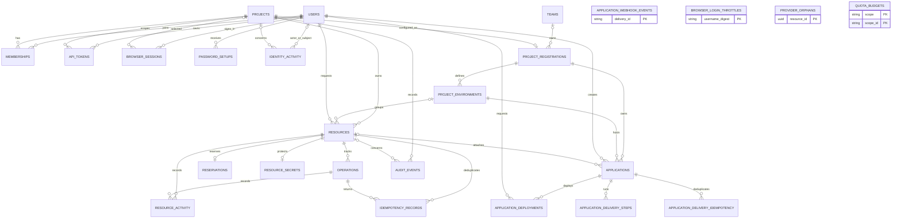

# Review relational model and create an Alembic baseline

## Current state

- **Updated:** 2026-11-13.
- **Authorized phase and scope:** Planning only. This record authorizes no schema edits, migration execution, or database deletion.
- **Next step:** Finalize the 25-table ERD and cross-project integrity rules before rebuilding the Alembic environment.
- **Open decisions:** Confirm whether any installed database with old revisions must retain data. Decide whether project registration is a separate lifecycle record or should be merged into identity's project; decide how to enforce project/environment/resource consistency at the database boundary.
- **Baseline:** `main` at `756ff31`. Existing staged changes include intentional removal of `backend/migrations/` to start fresh, plus README, settings, tests and Compose edits. Preserve unrelated work. Do not restore the old revision chain.
- **Latest verification:** Read-only inspection of ORM mappings and Git status. No PostgreSQL comparison, migration execution, or normalization proof has run.

## Goal and evidence

Produce an reviewed ERD and normalized PostgreSQL schema, then create one fresh Alembic baseline from the final SQLAlchemy metadata using `alembic revision --autogenerate` against an empty, disposable PostgreSQL database. Future model changes use new autogenerated candidate revisions, reviewed and adjusted before application. Alembic revisions must contain explicit `op.create_table`, `op.create_index`, `op.add_column`, and related operations; never `metadata.create_all()` or `drop_all()`.

Observed mappings: 9 identity tables in `backend/src/identity/infra/persistence/models.py`, 10 platform resource/project tables in `backend/src/devops_platform/infra/persistence/models.py`, 5 delivery tables in `backend/src/devops_platform/infra/persistence/delivery.py`, and `audit_events` in `backend/src/shared/infra/persistence/audit.py` (25 total). `backend/src/shared/infra/persistence/base.py` defines naming conventions. Existing history and documentation assume five revisions; `SCHEMA_REVISION` and integration fixtures refer to that history. The migration directory is currently absent from the worktree, so its final contents must be inspected again during implementation.

Normalization findings and decisions to confirm before implementation:

- `projects` and `project_registrations` repeat project name; the registration also stores `owning_team_id` and `owning_team_name`. `ledger_projects.py` writes both names and checks them for equality, while `delivery.py` queries registration by repository. Prefer `projects.name` and `teams.name` as canonical; keep registration only for platform configuration and derive names through joins, unless a documented snapshot requirement exists. This changes project DTO reads and registration writes.
- `resources` stores both `project_id` and nullable `environment_id`; `applications` stores both project and required environment IDs. `delivery.py:create_application()` checks project/environment equality before insert, but separate FKs permit later inconsistency or non-API writes. Prefer unique `(project_id, id)` on environments plus composite FK `(project_id, environment_id)` from both children; keep the nullable resource environment for legacy/unassigned resources. Check all resource writes before applying this contract.
- `api_tokens` stores user and project IDs separately; review whether active membership is enforced at issuance/authentication rather than by a composite foreign key.
- `provider_orphans.resource_id` intentionally has no FK: `worker_queue.py:reconcile()` inserts it only when the provider ID is absent from the resource ledger. Preserve this exception and document its lifecycle/retention.
- `application_delivery_idempotency.result_id` has no FK and may represent different result kinds. Trace every assignment/read before choosing a typed relation; do not add a misleading FK.
- JSONB columns (`resources.configuration`, `resources.endpoint`, delivery request payload and token scopes) need documented shape/ownership; normalize only fields that require relational integrity or queries.
- `audit_events`, `identity_activity`, and `resource_activity` overlap in purpose; establish retention and context ownership before combining or removing them.

## ERD inventory and integrity review

The following compact ERD covers the mapped ownership and principal relationships. Every table remains in scope for the full implementation ERD, including attributes, indexes and check constraints. `provider_orphans` is intentionally detached. `audit_events` is a shared legacy record whose owner needs an explicit decision.

Keys requiring explicit review: `memberships(user_id,project_id)` composite PK; `project_environments(project_id,name)` unique; `applications(project_id,name)` unique; `operations(resource_id,resource_revision,action)` unique; both idempotency tables unique by actor/project/route/key; `application_delivery_steps.idempotency_key` globally unique; token/session/setup digests unique. `quota_budgets(scope,scope_id)` is polymorphic, so a normal FK cannot cover both project and target: document the tradeoff or split target/project budgets if referential integrity is required. Check whether `application_webhook_events.repository` and `pull_request` need a registration FK or remain external event snapshots.

## Scope and invariants

- In scope: table/relationship audit; ERD; normalization decisions; metadata corrections justified by use cases; Alembic environment and one generated initial revision; readiness/test/documentation references.
- Out of scope: provisioning, API behavior changes unrelated to schema, live database reset, deployment.
- Preserve owners, resource leases, operations, idempotency, quotas, encrypted secret storage, audit history, and context ownership. No migration may print credentials or touch a non-disposable database.
- Treat a new baseline as a new installation path. Databases already stamped with old revisions require a separately planned data-preserving transition; never `stamp` them to the new head without schema verification.

## Acceptance criteria

- [ ] ERD lists all retained tables, primary/foreign keys, unique constraints, cardinalities, and intentional denormalization, grouped by owning context.
- [ ] Every proposed normalization change identifies the affected repository/query and data transition; no speculative table deletion.
- [ ] Alembic metadata imports all intended mappings; revision generation runs against a named, empty, disposable PostgreSQL database with an injected URL.
- [ ] Generated baseline has explicit Alembic operations for every table and required index/constraint; no `create_all`, `drop_all`, or runtime model import in the revision.
- [ ] Upgrade from base produces schema matching metadata with no pending autogenerated operations; downgrade on the disposable database removes only baseline objects.
- [ ] API/worker readiness revision, migration fixture, and developer commands match the new head; startup still does not migrate automatically.

## Contracts and ownership

Identity owns user, project membership, session, token, and team mappings. Platform owns resource, registration, environment, and delivery mappings. Shared audit ownership is an explicit open design decision. SQLAlchemy mappings remain in context `infra/persistence`; Alembic environment and revisions remain under `backend/migrations/`; `backend/alembic.ini` declares script location without a hard-coded credential or host. `DatabaseSettings` provides the URL at migration runtime. A migration revision is a historical snapshot and cannot import live ORM metadata.

## Plan and progress

1. Treat the staged deletion of old migrations as intentional. Inventory schema consumers and old-revision references; preserve all unrelated staged changes.
2. Finish the full 25-table ERD from mappings and repository behavior, including columns and constraints. Decide canonical project/team names and cross-project composite keys before any baseline is generated.
3. If schema changes are justified, update mappings and affected repositories together. Decide the transition for any persistent database before replacing revision history.
4. Initialize/configure Alembic's standard environment in `backend/migrations/` and set `target_metadata` by importing all mappings. Use an injected database URL and retain support for an externally supplied test connection. Never set a real database URL in `alembic.ini`.
5. Start a uniquely named, disposable PostgreSQL database with an empty schema. Run `alembic revision --autogenerate -m "initial schema"` through the Alembic CLI. Review generated operations, especially check constraints, defaults, indexes, foreign keys, and downgrade order; edit the generated candidate only to correct documented autogenerate limits.
6. Update expected revision and migration-specific tests/docs. On the disposable database run upgrade, schema comparison (`alembic check` or `compare_metadata`), downgrade, and a second upgrade. Stop on drift and fix the model/revision mismatch.
7. Remove only owned temporary container/schema after verification, record actual commands/results, and seek independent diff review for the substantial schema change.

## Verification and review

| Check or review | Actual result | Scope and limits |
| --- | --- | --- |
| ORM and repository inspection | 25 mapped tables; registration names duplicated; delivery validates environment/project in code; orphan rows intentionally have no resource FK | Full column-level ERD and PostgreSQL constraints not yet verified |
| Git baseline | `main` / `756ff31`; migration directory intentionally absent and deletions staged | Existing staged work preserved |

Review status: not performed.

### Agent activity

| Runtime agent/thread | Role and instruction source | Assigned scope and baseline | Actual findings and checks |
| --- | --- | --- | --- |
| None | No separate agent ran | Coordinator read-only planning | Source and Git inspection only |

## Handoff

- Completed: planning and initial normalization risk inventory.
- Remaining: repository behavior trace, ERD, decisions, Alembic scaffold/baseline, and PostgreSQL verification.
- Next concrete action: inspect the index/worktree migration state and trace project/environment consistency rules before selecting schema changes.
