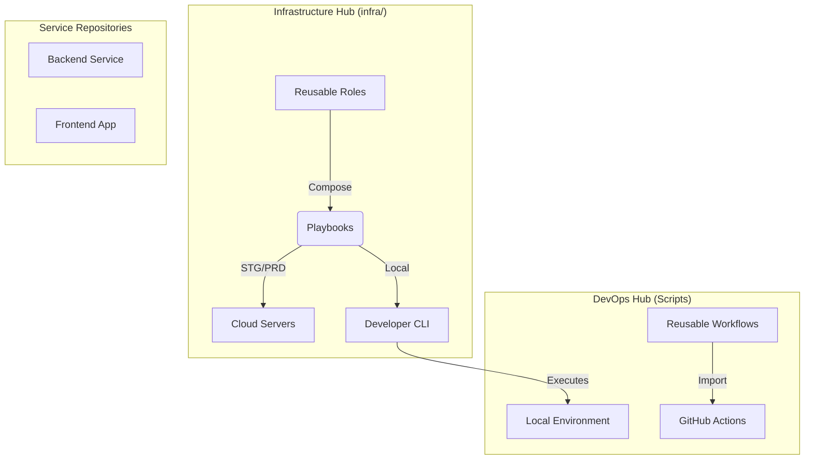
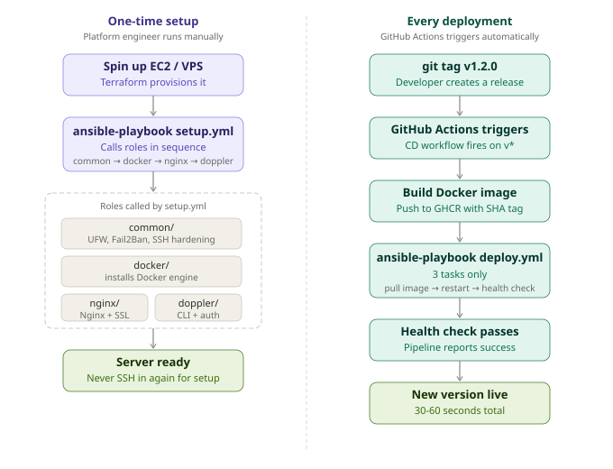
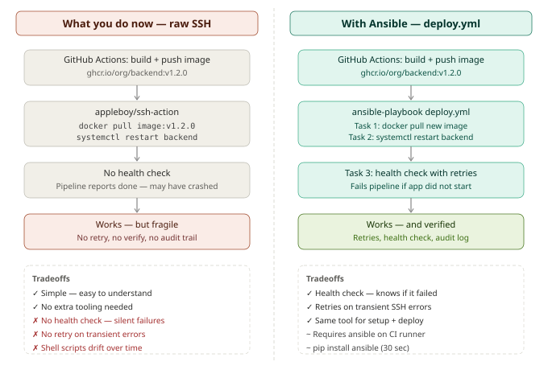

# TOB DevOps Component Hub

> Standardizing the developer experience through automated orchestration and operational intelligence.

The [Python API foundation](./backend/README.md) now provides health/readiness,
project-bound token authentication, lifecycle rules and control-plane migrations.
Resource provisioning and the Next.js dashboard are planned subsequent phases;
see the [backend workflow record](./.codex/workflow/tasks/backend-workflows.md).

---

## 💎 The Vision

In the Tracing Objectives Backwards (TOB) ecosystem, **DevOps is a product**, not a chore. This repository serves as the central "Command Center" for our engineering platform. By centralizing our CI/CD pipelines, local orchestration tools, and operational knowledge here, we ensure that every microservice inherits world-class engineering standards from day zero.

---

## 🏛 Ecosystem Architecture

The following diagram illustrates how this Hub empowers our service repositories (Backend, Frontend, etc.) with consistent automation and local tooling.

---

## 🧱 The Three Pillars

Our platform is engineered around three fundamental pillars of reliability.

### 🚀 1. Continuous Automation (Workflows)
Hands-off, high-performance CI/CD pipelines that handle the heavy lifting of validation and distribution.
- **Unified CI**: Standardized linting and testing for Node.js and Python.
- **Atomic CD**: Secure, registry-agnostic Docker image builds and GHCR publishing.
- **[View Workflow Reference](./docs/workflows.md)**

### 🛠 2. Intelligent Orchestration (`platform-dev`)
The local "Dev Engine" that harmonizes your machine with our production-grade architecture.
- **Sync**: Pulls the latest secrets from Doppler and locks dependencies via `uv`.
- **Boot**: One-command infrastructure startup with Docker Compose.
- **[Toolbox Deep-Dive](./docs/platform-dev.md)**

### 📖 3. Operational Intelligence (Knowledge)
The source of truth for everything from incident response to system scaling.
- **Runbooks**: Battle-tested recovery procedures for common infrastructure failures.
- **Scaling**: Standardized blueprints for adding new services to the cluster.
- **[Documentation Index](./docs/)**

---

## 🗺 Choose Your Path

### I'm a New Engineer
**Goal**: Get up and running in minutes.
- Follow the **[Zero-to-Hero Onboarding Guide](./docs/getting-started.md)** to configure your machine.

### I'm Feature Building
**Goal**: Daily development flow.
- Use `poe dev up` and `poe dev down` to manage your local stack.
- Check the **[Secrets Manual](./docs/secrets.md)** if adding new API keys.

### I'm Scaling the System
**Goal**: Adding a new service or infrastructure.
- Follow the **[Service Expansion Guide](./docs/new-service.md)** to ensure ecosystem compatibility.

---

## 🛠 Engineering Standards

| Area | Component | Philosophy |
| :--- | :--- | :--- |
| **Secrets** | [Doppler](https://doppler.com) | Centralized, encrypted, and injected—never committed. |
| **Runtime** | [Docker](https://docker.com) | If it runs in dev, it runs in prod. Zero "works on my machine." |
| **Python** | [uv](https://astral.sh) | Blazing fast, reproducible dependency management. |
| **Node.js** | [pnpm](https://pnpm.io) | Efficient, strict, and cached package handling. |

---

*Internal / Proprietary - Nicola Ibrahim Ecosystem*

