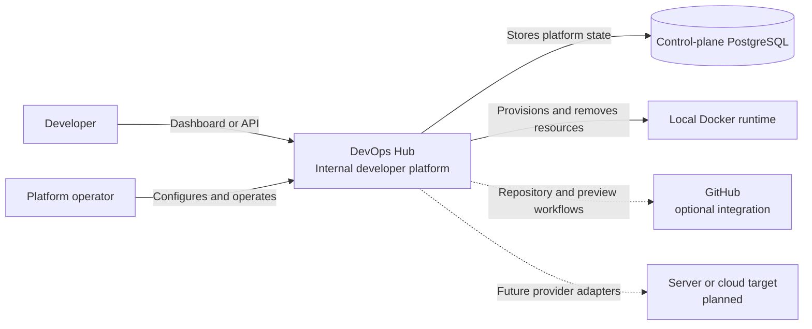
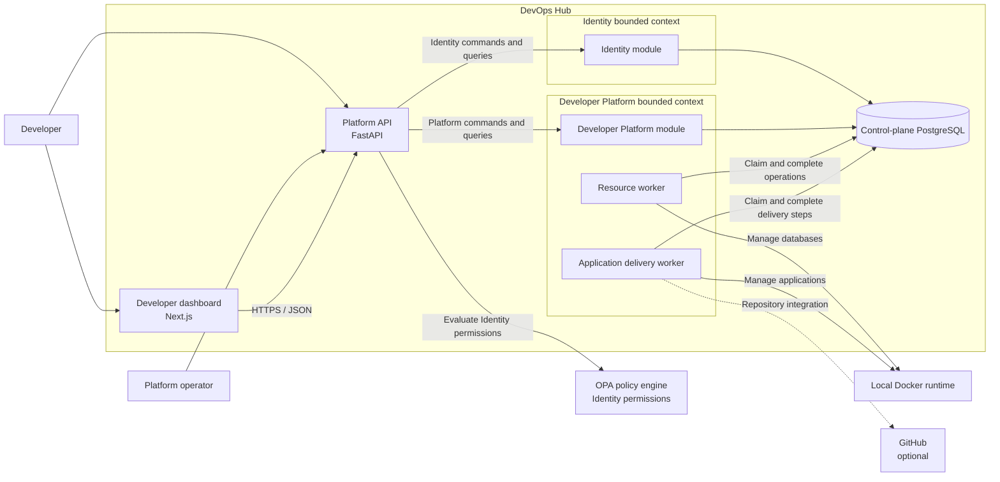
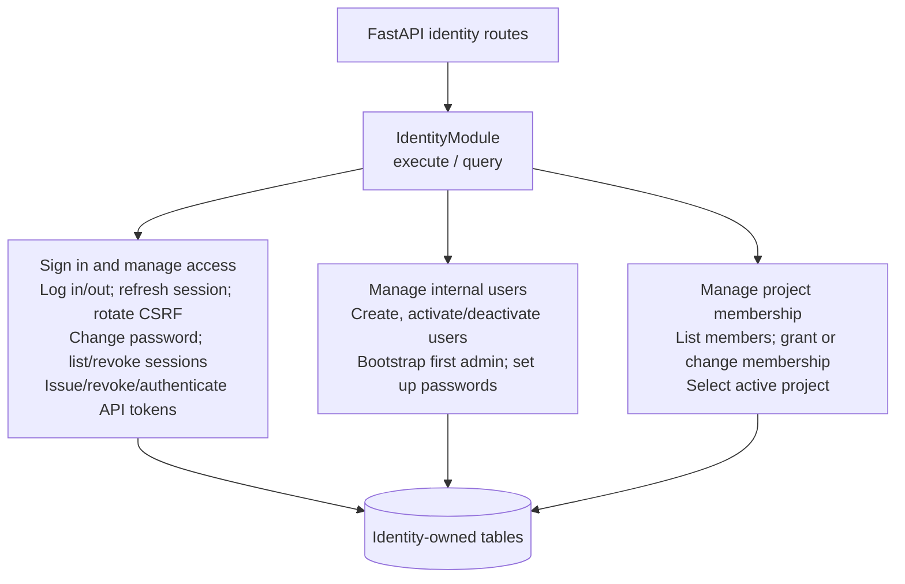
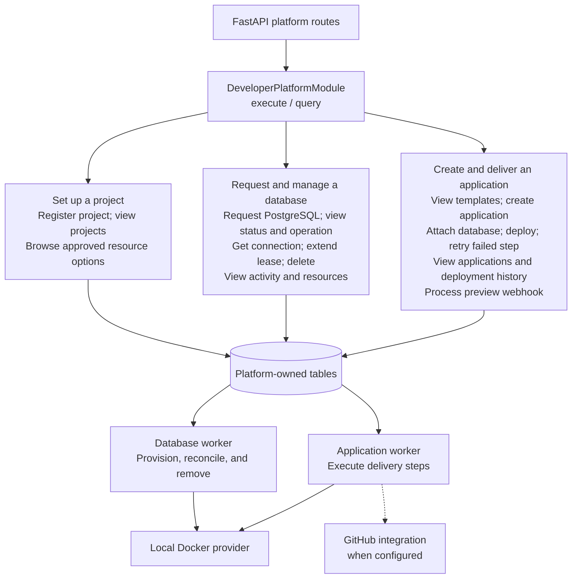
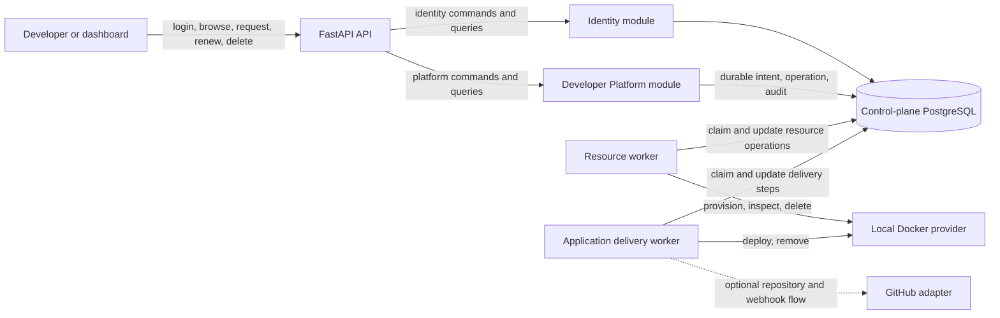

# DevOps Hub architecture

This document describes the current code structure and its intended boundaries.
It is an architecture map, not proof that every listed capability has completed
local, PostgreSQL, Docker, or cloud acceptance.

## C4 Level 1: System context

## C4 Level 2: Containers and bounded contexts

### Identity: access and administration

The Identity module dispatches these commands and queries. The boxes describe
application behavior; they are not separate deployed containers.

### Developer Platform: projects, databases, and applications

The Developer Platform module dispatches the developer-facing actions. Workers
execute durable resource and delivery steps after the API transaction commits.

## Bounded-context responsibilities

| Context | Owns | Public services offered to the API or workers |
| --- | --- | --- |
| Identity | Internal users, password credentials, browser sessions, API tokens, project membership | Sign in and manage access; manage internal users; manage project membership |
| Developer Platform | Project registration, approved catalog, temporary resources and leases, operations, application delivery | Set up a project; request and manage a database; create and deliver an application |

The API calls only the `IdentityModule` and `DeveloperPlatformModule` contracts. It does not choose handlers or issue SQL directly. The resource and delivery workers use durable operations and delivery steps so provider effects can be retried after a restart.

## Trigger map

## Domain-first rules

- Identity and Developer Platform are independent bounded contexts. Cross-context actor mapping belongs in the host or composition layer.
- Domain code owns business state and invariants. Application handlers orchestrate one use case through domain objects and interfaces.
- A repository corresponds to an aggregate or named transactional capability. The current resource aggregate uses `SQLAlchemyResourceRepository`; application delivery uses `SQLAlchemyApplicationDeliveryRepository`.
- SQLAlchemy, Docker, GitHub, encryption, and future AWS SDK calls belong in infrastructure. A future AWS adapter must implement an application port; the domain must not import cloud SDKs.
- HTTP authentication and project permission checks happen at the API/HTTP host boundary. The host owns transaction completion. Workers perform provider effects only after durable intent has committed.

## Current limits

- The local Docker target is the implemented demonstration target. Configured server, Kubernetes, and cloud targets remain future adapter work.
- GitHub integration is optional and configuration dependent.
- A database request being recorded does not mean a database is ready. The resource worker must confirm readiness and record the result.
- The dashboard is a client of the API; it does not contain platform lifecycle rules.
